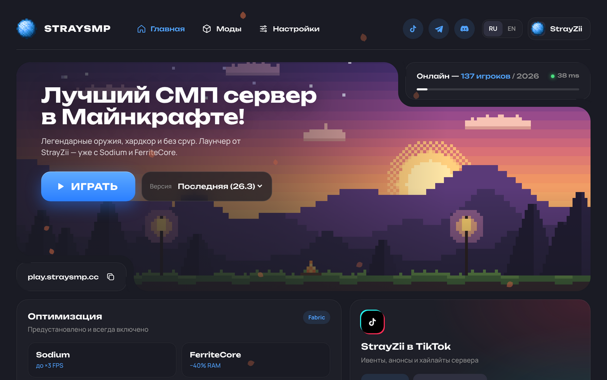
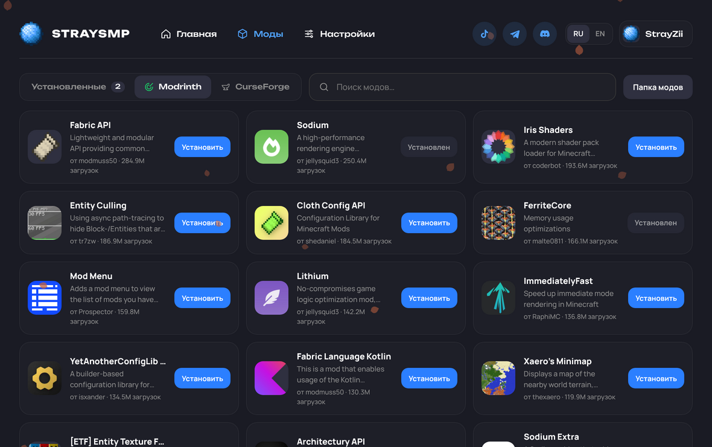
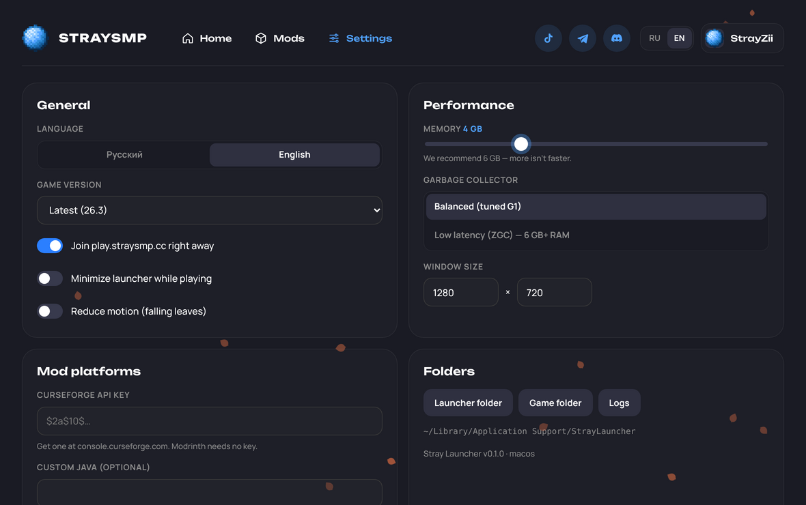

<div align="center">


# Stray Launcher

**Fast, native Minecraft launcher for [StraySMP](https://shop.straysmp.cc) · by the StrayZii community**

macOS (Apple Silicon + Intel) · Windows · Русский / English



</div>

---

## Features

| | |
|---|---|
| ⚡ **Native Rust + Tauri** | ~10 MB app, uses the system webview instead of shipping Chromium. Starts instantly and stays light while you play: animations pause and status polling stops while Minecraft is running. |
| 🧩 **Sodium + FerriteCore built in** | Installed automatically for every version and locked on. One-click extras: Lithium, ImmediatelyFast, EntityCulling, ModernFix. |
| 📦 **Modrinth + CurseForge** | Search, install, enable/disable, remove. Required dependencies are resolved automatically. Only Fabric builds for your game version are shown. |
| ☕ **No Java install needed** | Uses Mojang's official Java runtimes (the same ones as the vanilla launcher), picked per game version. |
| 🚀 **Parallel, verified downloads** | 48 concurrent HTTP/2 connections, SHA-1 checked, atomic writes. Measured: full first install of 26.3 (Java 25, ~5,100 assets, Fabric, mods) in **19 s**; warm start check in **0.18 s**. |
| 🎯 **Straight onto the server** | Quick Play joins `play.straysmp.cc` as soon as the game opens. Live player counter via Server List Ping (SRV records are followed). |
| 🧠 **Tuned JVM** | Tuned G1 flags by default, or generational ZGC for machines with plenty of RAM. On JDK 25+ we add `-XX:+UseCompactObjectHeaders` (smaller heap). RAM recommendation is based on your system. |
| 🔐 **Microsoft login** | Device-code sign-in on microsoft.com. Tokens never reach the UI. |
| 🌍 **RU / EN** | Switch any time in the header or Settings. |

 

### Stray Launcher vs. Dawn

The goal is to beat Dawn for StraySMP players: get people into the game faster and with less overhead.

- **Smaller and lighter:** a 10 MB native binary, no bundled browser engine.
- **Performance by default:** Sodium + FerriteCore always on, tuned GC flags, compact object headers on new JDKs.
- **Open mod ecosystem:** both Modrinth *and* CurseForge, with dependency resolution.
- **Server-first:** one button takes you from launch to `play.straysmp.cc`.
- **Fully open source** and built in public by GitHub Actions. Every installer can be traced to a commit.

---

## Download

Grab the latest installer from **[Releases](../../releases)**:

- **macOS:** `Stray.Launcher_x.y.z_universal.dmg`. The app isn't notarized yet, so on first launch right-click → *Open*, or run `xattr -cr "/Applications/Stray Launcher.app"`.
- **Windows:** `Stray.Launcher_x.y.z_x64-setup.exe` (or `.msi`). SmartScreen may warn about an unknown publisher → *More info* → *Run anyway*.

Every push to `main` also produces installers as workflow artifacts under **Actions → Build**.

---

## Building / Сборка

Everything is built by GitHub Actions (`.github/workflows/build.yml`):

- **Push to `main` / PR:** `fmt` + `clippy` + tests, then macOS universal `.dmg` and Windows `.exe`/`.msi` as artifacts.
- **Tag `v*`** (e.g. `git tag v0.1.0 && git push --tags`): additionally publishes a GitHub Release with the installers attached.

### Repository secrets (Settings → Secrets → Actions)

| Secret | Required for | How to get it |
|---|---|---|
| `STRAY_MSA_CLIENT_ID` | Microsoft login | See below |
| `CURSEFORGE_API_KEY` | CurseForge tab (users can also enter their own key in Settings) | [console.curseforge.com](https://console.curseforge.com) |

#### Microsoft login (Client ID)

1. [Azure Portal → App registrations](https://portal.azure.com/#view/Microsoft_AAD_RegisteredApps/ApplicationsListBlade) → *New registration*. Supported accounts: **Personal Microsoft accounts only**.
2. *Authentication* → enable **Allow public client flows**.
3. Copy the *Application (client) ID* into the `STRAY_MSA_CLIENT_ID` secret.
4. New apps must be approved by Mojang before they can use the Minecraft API: submit the ID at <https://aka.ms/mce-reviewappid>. Until it's approved, sign-in fails at the last step.

### Local build

```bash
# Prerequisites: Rust stable, Node (for the Tauri CLI). Linux also needs webkit2gtk-4.1.
npx @tauri-apps/cli@2 dev      # run with hot reload
npx @tauri-apps/cli@2 build    # installers in target/release/bundle
cargo test -p stray-core
```

The UI is plain HTML/CSS/JS in `ui/` (no bundler). If you open `ui/index.html` in a browser it uses a mock backend that talks to the public Modrinth API, which is handy for design work.

---

## Project layout

```
crates/stray-core/   Launcher logic, no GUI (testable on its own)
  mojang.rs          version manifest, libraries, assets, rule evaluation
  fabric.rs          Fabric loader profile merged over vanilla
  java.rs            Mojang Java runtimes
  mods.rs            Modrinth + CurseForge, dependency resolution, Sodium/FerriteCore
  auth.rs            Microsoft → Xbox → XSTS → Minecraft
  launch.rs          parallel prepare, JVM flags, argument building, spawn
  ping.rs            Server List Ping (+SRV)
  download.rs        parallel verified downloader
src-tauri/           Tauri shell + commands
ui/                  Interface (Unbounded + Manrope fonts, StraySMP palette)
tools/gen_hero.py    generates the pixel-art hero image
```

Data lives in `%APPDATA%\StrayLauncher` (Windows) or `~/Library/Application Support/StrayLauncher` (macOS). Libraries, assets and runtimes are shared between versions; every game version gets its own instance folder with its own mods.

---

## Русский

**Stray Launcher** — быстрый лаунчер Minecraft для сервера **StraySMP** (play.straysmp.cc) от сообщества StrayZii.

- Нативное приложение на Rust (~10 МБ), macOS и Windows.
- **Sodium и FerriteCore** предустановлены и всегда включены. Lithium, ImmediatelyFast, EntityCulling и ModernFix ставятся в один клик.
- Моды из **Modrinth и CurseForge**, зависимости подтягиваются автоматически.
- Java ставить не нужно: используется официальная Java от Mojang.
- Кнопка «Играть» сразу заходит на play.straysmp.cc.
- Вход через Microsoft. Интерфейс на русском и английском.

Скачать: раздел **[Releases](../../releases)**.

---

<sub>Not an official Minecraft product. Not approved by or associated with Mojang or Microsoft. StraySMP and StrayZii names are used for the community this launcher is made for.</sub>
