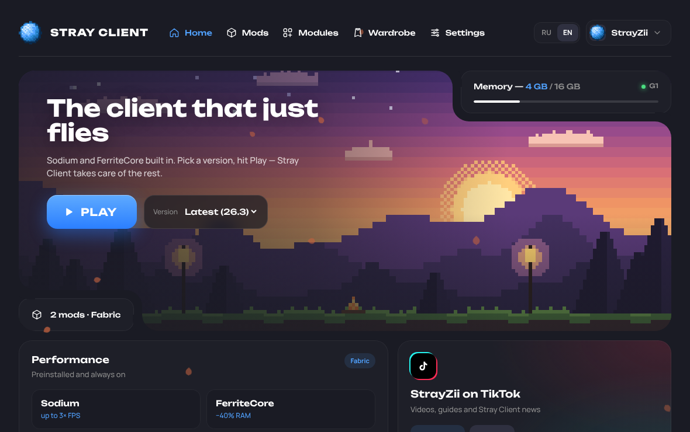
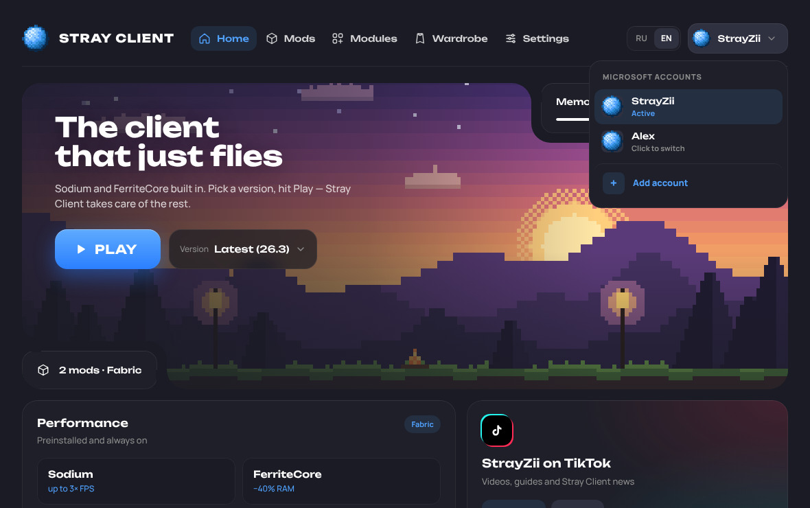
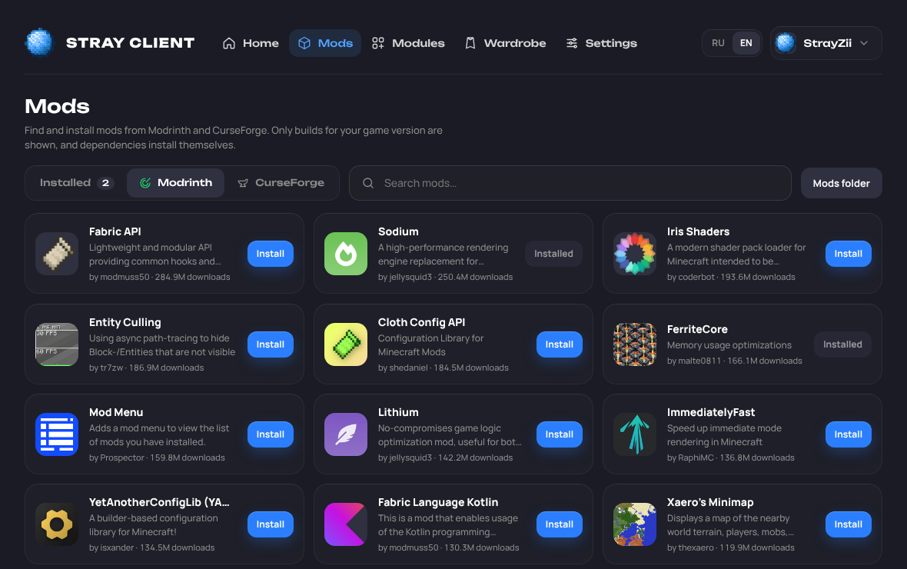
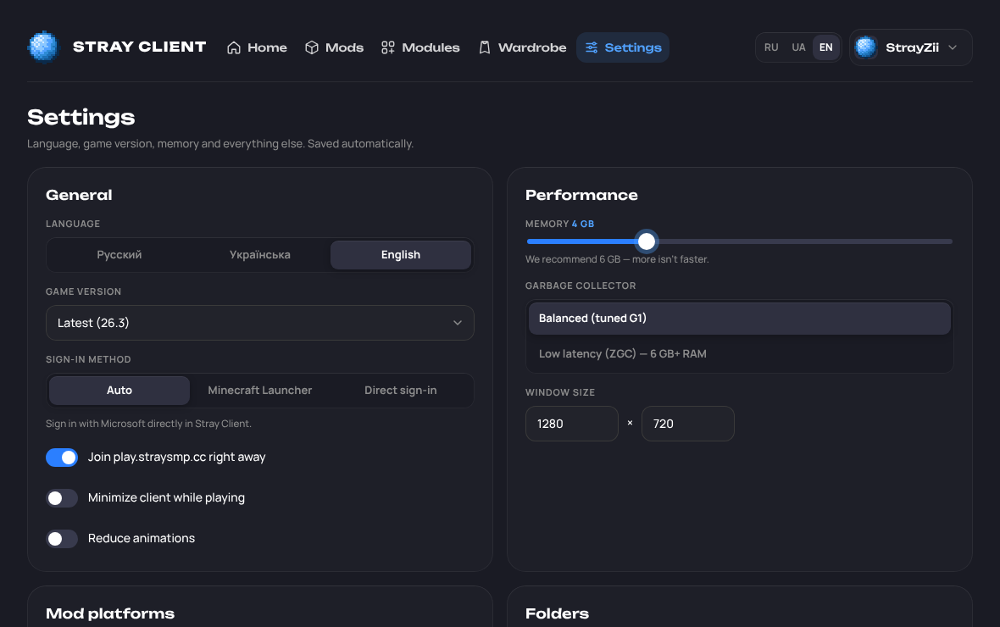

<div align="center">


# Stray Client

**The official [StraySMP](https://shop.straysmp.cc) client · by StrayZii**

A fast, native Minecraft client built in Rust

macOS (Apple Silicon + Intel) · Windows · Русский / English



</div>

---

## Features

| | |
|---|---|
| ⚡ **Native Rust + Tauri** | ~10 MB app, uses the system webview instead of shipping Chromium. Starts instantly and stays light while you play: animations pause and status polling stops while Minecraft is running. |
| 🧩 **Sodium + FerriteCore built in** | Installed automatically for every version and locked on. One-click extras: Lithium, ImmediatelyFast, EntityCulling, ModernFix. |
| 📦 **Modrinth + CurseForge** | Search, install, enable/disable, remove. Required dependencies are resolved automatically. Only Fabric builds for your game version are shown. |
| ☕ **No Java install needed** | Uses Mojang's official Java runtimes (the same ones as the vanilla launcher), picked per game version. |
| 🚀 **Parallel, verified downloads** | 48 concurrent HTTP/2 connections, SHA-1 checked, atomic writes. Measured: full first install of 26.3 (Java 25, ~5,100 assets, Fabric, mods) in **19 s**; warm start check in **0.18 s**. |
| 🎯 **Straight onto the server** | Quick Play joins `play.straysmp.cc` as soon as the game opens. Live player counter via Server List Ping (SRV records are followed). |
| 🧠 **Tuned JVM** | Tuned G1 flags by default, or generational ZGC for machines with plenty of RAM. On JDK 25+ we add `-XX:+UseCompactObjectHeaders` (smaller heap). RAM recommendation is based on your system. |
| 🔐 **Sign-in** | Works out of the box through the **official Minecraft Launcher**: Stray Client sets everything up, writes a “Stray Client” profile and opens the launcher, which signs you in and checks the license. With a Microsoft client ID in the build, direct sign-in like Lunar Client is available too (own window, several accounts, one-click skin upload). |
| 🌍 **RU / EN** | Switch any time in the header or Settings. |
| 👕 **Skins** | Upload a PNG (64×64 / 64×32) or copy any player's skin, pick Classic/Slim, and apply it to your account through the official Minecraft API, so everyone sees it on every server. |
| 🧣 **Capes** | Your own cape from a PNG with a live front/back preview. Powered by our small **Stray Client** mod (`mods/stray-client`, MIT) for Minecraft 26.x; the cape is shown on your own player. |
| 🖼️ **StraySMP loading screen** | The Minecraft loading screen shows the StraySMP logo on navy instead of “Mojang Studios” on red (part of the Stray Client mod). |
| ⌨️ **Modules** | Keystrokes HUD: WASD, mouse clicks with CPS, space bar, FPS and ping. The launcher installs and configures *Modern Keystrokes* for you. |
| 🍎 **Apple Silicon** | A separate native build for M1–M4 (`target-cpu=apple-m1`), native ARM Java without Rosetta, and GC threads sized to the performance cores. |

 
 

### Stray Client vs. Lunar, Badlion and Dawn

The goal: a faster, lighter client than Lunar, Badlion and Dawn, with an open mod ecosystem.

- **Smaller and lighter:** a 10 MB native binary, no bundled browser engine.
- **Performance by default:** Sodium + FerriteCore always on, tuned GC flags, compact object headers on new JDKs.
- **Open mod ecosystem:** both Modrinth *and* CurseForge, with dependency resolution.
- **Server-first:** one button takes you from launch to `play.straysmp.cc`.
- **Fully open source** and built in public by GitHub Actions. Every installer can be traced to a commit.

---

## Download

Download page (RU/EN switch at the top): **https://mumafi.github.io/StrayClient/** · or grab the latest installer from **[Releases](../../releases)**:

- **macOS:** `Stray.Client_x.y.z_aarch64.dmg` for Apple Silicon (M1–M4), `Stray.Client_x.y.z_x64.dmg` for Intel Macs. Open the `.dmg` and drag Stray Client into Applications.
  The app isn't notarized by Apple yet, so macOS may say **“Stray Client is damaged and can't be opened”**. It isn't damaged: click **Cancel** (not *Move to Trash*), make sure the app is in Applications, open Terminal and run once (removes the download flag and signs the app locally):
  ```bash
  xattr -cr "/Applications/Stray Client.app" && codesign --force --deep --sign - "/Applications/Stray Client.app"
  ```
  The website shows this as a step-by-step guide when you download.
- **Windows:** `Stray.Client_x.y.z_x64-setup.exe` (or `.msi`). SmartScreen may warn about an unknown publisher → *More info* → *Run anyway*.

Every push to `main` also produces installers as workflow artifacts under **Actions → Build**.

---

## Building / Сборка

Everything is built by GitHub Actions (`.github/workflows/build.yml`):

- **PR:** `fmt` + `clippy` + tests, then macOS universal `.dmg` and Windows `.exe`/`.msi` as artifacts.
- **Push to `main`:** the same, plus it publishes (or updates) the GitHub Release `v<version>` with the installers attached. To cut a new release, bump `version` in `src-tauri/tauri.conf.json` (and the root `Cargo.toml`).

### Repository secrets (Settings → Secrets → Actions)

| Secret | Required for | How to get it |
|---|---|---|
| `STRAY_MSA_CLIENT_ID` | Microsoft login | See below |
| `CURSEFORGE_API_KEY` | CurseForge tab (users can also enter their own key in Settings) | [console.curseforge.com](https://console.curseforge.com) |

#### Microsoft login (Client ID)

Without a client ID the client plays through the official Minecraft Launcher, so this is optional. Step-by-step guide in Russian for the server owner: [docs/MICROSOFT-LOGIN.ru.md](docs/MICROSOFT-LOGIN.ru.md).

1. [Azure Portal → App registrations](https://portal.azure.com/#view/Microsoft_AAD_RegisteredApps/ApplicationsListBlade) → *New registration*. Supported accounts: **Personal Microsoft accounts only**.
2. *Authentication* → *Add a platform* → **Mobile and desktop applications** → tick the redirect URI `https://login.microsoftonline.com/common/oauth2/nativeclient`. Also enable **Allow public client flows** (needed for the "use a code instead" fallback).
3. Copy the *Application (client) ID* into the `STRAY_MSA_CLIENT_ID` secret.
4. New apps must be approved by Mojang before they can use the Minecraft API: submit the ID at <https://aka.ms/mce-reviewappid>. Until it's approved, sign-in fails at the last step.

### Local build

```bash
# Prerequisites: Rust stable, Node (for the Tauri CLI). Linux also needs webkit2gtk-4.1.
npx @tauri-apps/cli@2 dev      # run with hot reload
npx @tauri-apps/cli@2 build    # installers in target/release/bundle
cargo test -p stray-core
```

The UI is plain HTML/CSS/JS in `ui/` (no bundler). Opened in a browser, `ui/index.html` runs as an interactive demo with a browser backend (live Modrinth search, demo accounts). The website embeds it, and you can try it at https://mumafi.github.io/StrayClient/ui/index.html.

---

## Project layout

```
crates/stray-core/   Launcher logic, no GUI (testable on its own)
  mojang.rs          version manifest, libraries, assets, rule evaluation
  fabric.rs          Fabric loader profile merged over vanilla
  java.rs            Mojang Java runtimes
  mods.rs            Modrinth + CurseForge, dependency resolution, Sodium/FerriteCore
  auth.rs            Microsoft → Xbox → XSTS → Minecraft
  launch.rs          parallel prepare, JVM flags, argument building, spawn
  ping.rs            Server List Ping (+SRV)
  download.rs        parallel verified downloader
src-tauri/           Tauri shell + commands
ui/                  Interface (Unbounded + Manrope fonts, StraySMP palette)
mods/stray-client/   our Fabric mod for 26.x: StraySMP loading screen + capes (build.sh + fetch_deps.py)
tools/gen_hero.py    generates the pixel-art hero image
```

Data lives in `%APPDATA%\StrayLauncher` (Windows) or `~/Library/Application Support/StrayLauncher` (macOS). Libraries, assets and runtimes are shared between versions; every game version gets its own instance folder with its own mods.

---

## Русский

**Stray Client** — официальный клиент сервера **StraySMP** (play.straysmp.cc) от StrayZii: быстрый и лёгкий клиент Minecraft.

- Нативное приложение на Rust (~10 МБ), macOS и Windows.
- **Sodium и FerriteCore** предустановлены и всегда включены. Lithium, ImmediatelyFast, EntityCulling и ModernFix ставятся в один клик.
- Моды из **Modrinth и CurseForge**, зависимости подтягиваются автоматически.
- Java ставить не нужно: используется официальная Java от Mojang.
- Кнопка «Играть» сразу заходит на play.straysmp.cc.
- Вход через Microsoft. Интерфейс на русском и английском.

Скачать: раздел **[Releases](../../releases)**.

---

<sub>The official client of StraySMP, developed together with the StraySMP team. Not an official Minecraft product. Not approved by or associated with Mojang or Microsoft.</sub>
